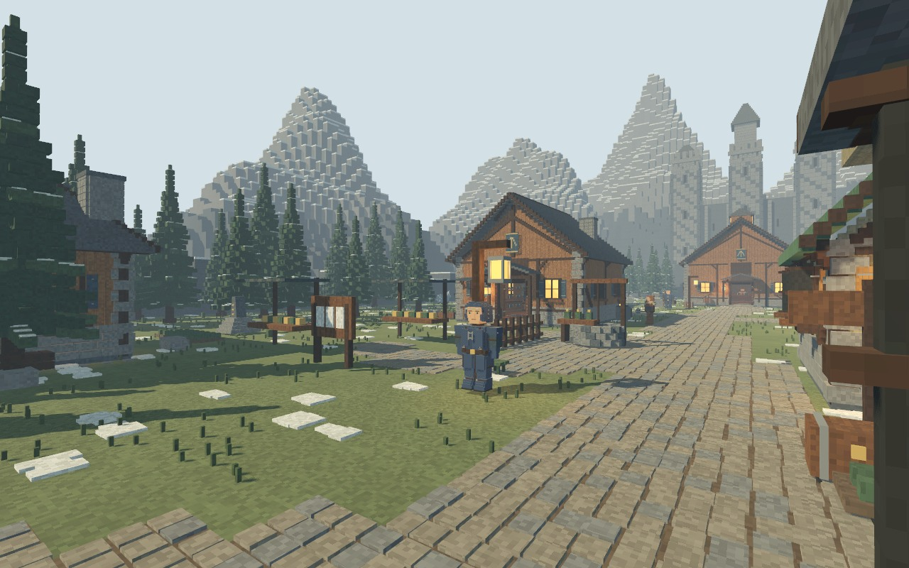
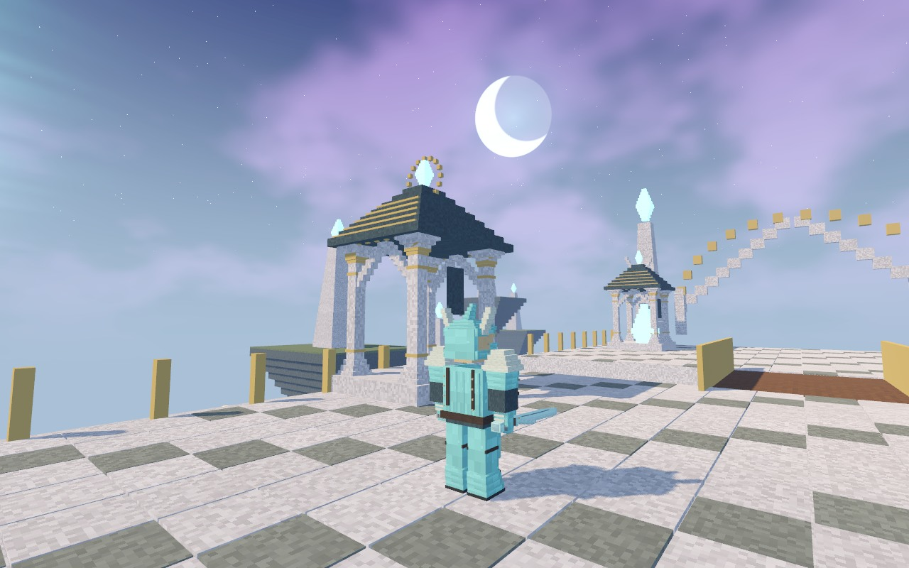
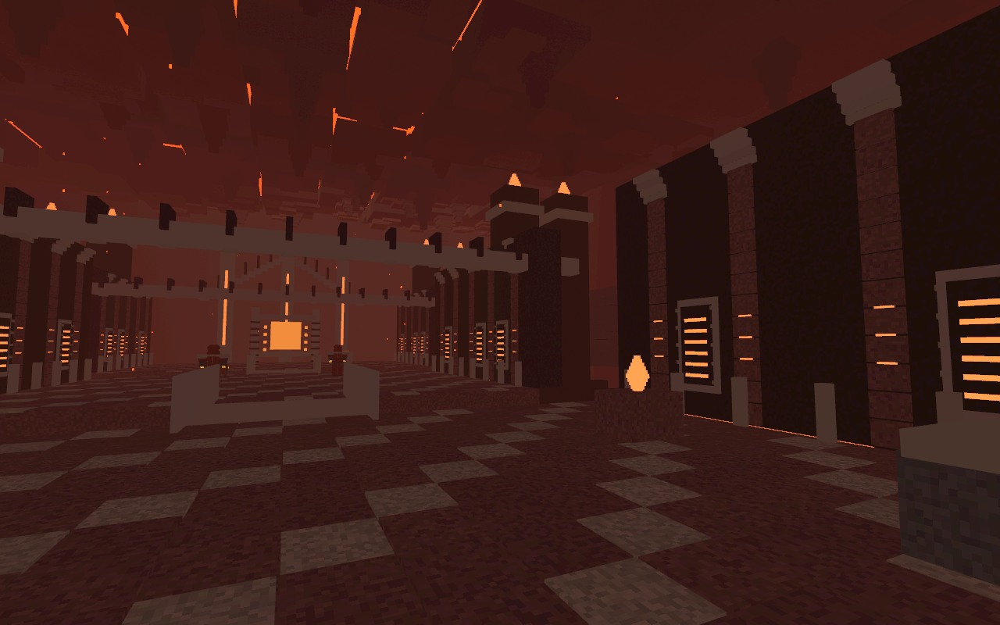
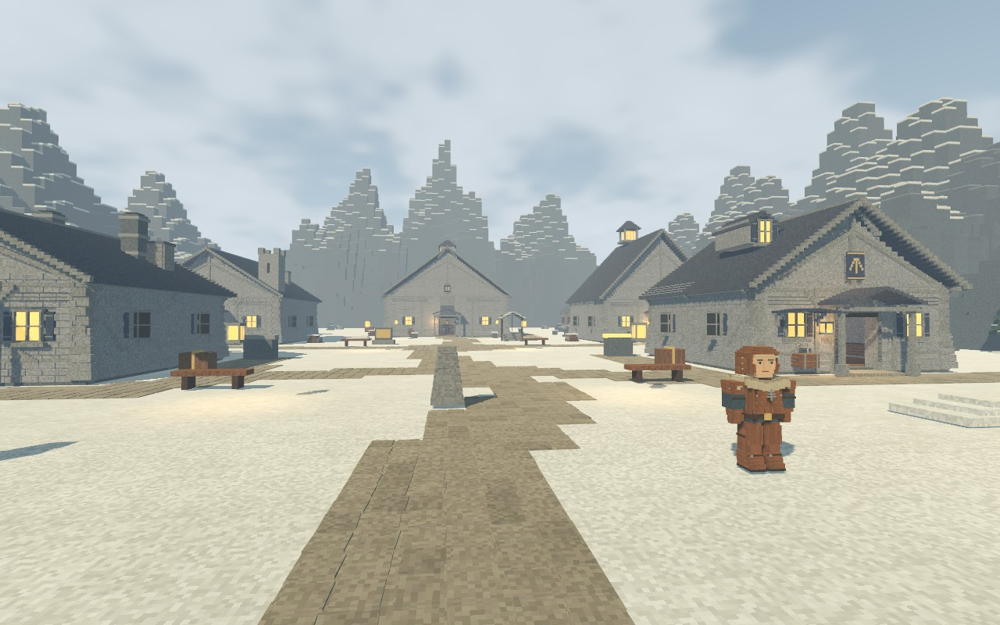
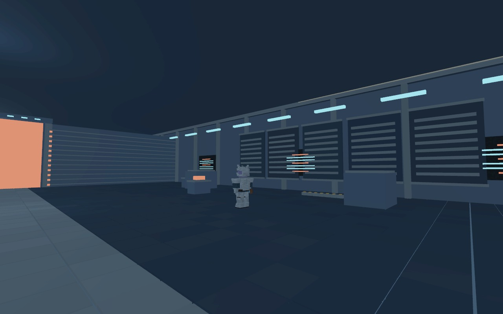

# Frostmere

**A single-player fantasy RPG about exploring strange places, fighting enormous
things, and bringing home gear worth improving.**

Detailed block-built towns and mountains. A dark Nordic adventure. Crystal skies,
an abandoned space station, and a furnace world waiting later in the story.
Built with Godot. Open source under **BSD-3-Clause**.

**[Download the Windows x64 playtest](https://github.com/gonz0w/frostmere/releases/tag/windows-test-2026-11-07)**
— a ~48 MiB standalone ZIP for Windows 10/11 testers. Extract all files and run
`Frostmere.exe`; no editor or programming tools required.
[Checksum](https://github.com/gonz0w/frostmere/releases/download/windows-test-2026-11-07/Frostmere-Windows-x64-8ab158a5d324.zip.sha256)
· [Player instructions](docs/WINDOWS_PLAYTEST.txt)
· [Windows feedback](https://github.com/gonz0w/frostmere/issues/26)

This unsigned experimental build targets Intel/AMD x64 PCs with Vulkan-capable
graphics. Native Windows qualification remains open; minimum hardware and Windows ARM
are not qualified. Back up existing saves before trying development builds.



## What you can play

Leave town with a quest and a bag of supplies. Explore a mountain route, clear an
encounter, collect materials and return to the forge with something worth upgrading.
Join factions, follow side stories and build your character around the weapons,
armor and spells you enjoy. The later destination chapters bring new enemies and
gear into the same adventure; the Nordic home world remains its center.


- Explore handcrafted regions, enter towns and shops, and follow **51 implemented
  main, faction and side quests** with choices and persistent progress.
- Collect, forge, temper, enchant, socket and salvage equipment. Experiment with
  armor, weapons, skills and four saved equipment loadouts.
- Switch between first and third person. Fight with melee weapons, bows, magic
  and later-world firearms; parry, charge power attacks and finish weakened foes.
- Encounter giant beasts, crystal-winged guardians, alien creatures and a living
  furnace. Travel through connected destination chapters and return with their gear.
- Hear original synthesized exploration/battle music and find a little gallows
  humor among the warm stones, missing names and alarming safety instructions.

**Playable development prototype, not a finished release.** Campaign pacing,
reliability, content depth and hardware qualification still need work. The current
world is fixed; this is not a terrain-building sandbox. Existing quest implementation
does not mean the whole campaign has been human-playtested or balanced.

| Platform | Current status |
| --- | --- |
| macOS / Apple Silicon | Native development and review evidence on M5 Max. M1 / 32 GB qualification remains open. |
| Windows / x86_64 | [Experimental ZIP available](https://github.com/gonz0w/frostmere/releases/tag/windows-test-2026-11-07); native qualification remains open in [#26](https://github.com/gonz0w/frostmere/issues/26). |
| Linux | Target platform; native support is not yet verified. |

See [issues](https://github.com/gonz0w/frostmere/issues) and
[capability milestones](https://github.com/gonz0w/frostmere/milestones) for live work.
Build contributors can reproduce the package using the
[Windows build guide](docs/WINDOWS_BUILD.md).

## Development progress

**November 7, 2026 — Windows playtesting is open.** The first experimental Windows
package includes both game and console launchers, licenses, build provenance and
checksums. Export/package checks and automated CI passed; native Windows gameplay
results are the next step. [Delivery evidence #45](https://github.com/gonz0w/frostmere/issues/45)

Recent completed work:

- **Save backup and corruption recovery:** tested restoration and fresh-process
  recovery paths. [#8](https://github.com/gonz0w/frostmere/issues/8)
- **Two-hour native M5 stress run:** three verified restarts, 240 crafting operations
  and 720 travel transitions without save/restart failures. This used a scripted
  stability workload; one frame stall remains tracked in
  [#24](https://github.com/gonz0w/frostmere/issues/24).
  [Run evidence #9](https://github.com/gonz0w/frostmere/issues/9)
- **Quest and presentation review:** faction/quest ordering qualification and owner
  review of towns, landscapes, opening and audio completed.
  [#6](https://github.com/gonz0w/frostmere/issues/6) ·
  [#7](https://github.com/gonz0w/frostmere/issues/7)

At this snapshot, full warrior/ranger/mage campaign playthroughs and economy tuning
remain open, alongside Windows/Linux and M1 hardware qualification. The linked
[issues and milestones](https://github.com/gonz0w/frostmere/milestones) are the
current work record; these results do not imply a finished or fully balanced game.

## A few places beyond home

| Aeralis | The Crucible |
| --- | --- |
|  |  |

| Wyrmkeep | First Threshold |
| --- | --- |
|  |  |

[More screenshots and capture details](docs/screenshots/README.md). These actual
in-game captures were taken on M5/Metal during the September 24 landscape review;
they show the game's art direction, not native Windows test evidence.

## Play from source

Install [Godot 4.7.2](https://github.com/godotengine/godot/releases/tag/4.7.2-stable)
(the standard build; .NET is not needed) and Git. On a Mac, place Godot in
`/Applications` or put its executable on PATH. The source contains its original
assets; you do not need to install audio-generation packages to play.

```sh
git clone https://github.com/gonz0w/frostmere.git
cd frostmere
godot --editor --path .
```

Let the first import finish, then press **F5**, or run `godot --path .` from this directory. On macOS,
`Play Frostmere.command` also finds `/Applications/Godot.app`. If `godot` is not
on PATH, use its full executable path or import `project.godot` from the Godot
project manager. Windows users should use the Godot console executable for logs.
Windows/Linux play remains experimental until their qualification issues close.

New characters begin with **Ash Through the Snow**. Walk to the lantern and press
**E**, or **Tab** to skip. In Frostmere, find Edda at the forge. Your adventure
autosaves; back up existing profiles before experimenting with development changes.
The historical application identity remains unchanged to preserve old save paths.
See [save behavior and recovery limits](docs/SAVE_RESUME.md).

| Key | Action |
| --- | --- |
| WASD / mouse, Shift, Space | Move/look, sprint, jump |
| V / E | Switch camera / interact |
| Left / right mouse | Attack / block or timed parry |
| Q / B / F | Cast / cycle spells / heal |
| G / Shift+G / X | Charged sweep / forward power strike / finisher |
| I / C / K / M | Inventory/crafting / character / skills / map and journal |
| Escape / H | Pause and settings / show or hide controls |

## Verify your setup

For source contributors, install Python 3.11+ and run:

```sh
python3 tools/verify_repo.py
godot --headless --path . --editor --import --quit
godot --headless --path . --script tests/smoke.gd
```

The source checker validates publication hygiene, the pinned method and maintained
entry-point links. The smoke fixture checks scene/movement behavior with normal
saving disabled. These checks do not establish visual quality, campaign balance
or cross-platform support. See [all required contributor checks](CONTRIBUTING.md).

## Help shape the game

Start with an issue: report a reproducible bug, discuss an encounter or contribute
to an agreed milestone. Useful help includes native Windows/Linux testing, M1
profiling, accessibility, campaign playtesting and original art/audio improvements.
Please discuss substantial features before implementing them.

- [Player and developer documentation](docs/README.md)
- [Contribute](CONTRIBUTING.md) · [Project policy](PROJECT.md) · [Agent instructions](AGENTS.md)
- [Report a problem](https://github.com/gonz0w/frostmere/issues/new/choose)
- [Security and sensitive reports](SECURITY.md)
- [BSD-3-Clause license](LICENSE) · [Third-party and asset notices](THIRD_PARTY_NOTICES.md)

Copyright © 2026 gonz0w. Frostmere is an original independent project.
