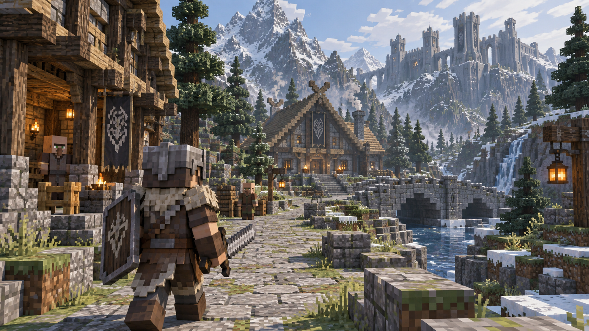

> Historical development record. Live work moved to [GitHub Issues](https://github.com/gonz0w/frostmere/issues) on November 1, 2026. Earlier counts, priorities, unchecked lists and build links below are retained as dated evidence, not current assignments. See [project policy](../PROJECT.md).

# Visual-detail roadmap

Status: **in progress, substantial remaining work; required before the next release.** Added September 13, 2026. Earlier geometry, animation and voxel-spacing improvements remain useful groundwork, but do not satisfy this milestone.

## Creature roster review checkpoint — September 24, 2026

**Roadmap item #1 implementation pass covered for the full current creature roster; stopped for user visual review.** This is not approval of the entire art milestone or a performance sign-off.

| Creature family | Construction and presentation delivered | Review status |
| --- | --- | --- |
| Frostfang Wolf | Shaped trunk/muzzle, shoulder ruff, paws/teeth, articulated bite, finisher recoil and side collapse | Ready |
| Bristleback Boar | Broad shoulders, bristle ridge, swept tusks, hooves, bite and collapse | Ready |
| Mossbound Colossus | Staggered stone slabs, moss seams, recessed eyes, articulated fists/slam arms, kneeling defeat | Ready |
| Hollow Warden | Bark ribs, layered moss, branched antlers, root feet, braced warning and root-limb collapse | Ready |
| Hull Warden | Domed barnacle shell, eye stalks, hooked pincers, opening core plates and folded defeat | Ready |
| Dissonant Cantor | Tapered resonant chest, fluted throat, ribbed wings, inhale expansion and folded-wing defeat | Ready |
| Meridian Keeper | Segmented golden carapace, pincers, articulated solar tail, warning alignment and collapsed tail | Ready |
| Hullcarver | Layered alien carapace, recessed eye clusters, serrated mandibles, core covers; existing spit/finisher/collapse retained | Ready |
| Shadowless Stag | Shaped pale body, visible ribs, tapered neck/legs, branched antlers; shadowless noncombat quest behavior retained | Ready |
| Rimefang | Existing refined anatomy plus finisher reaction, animated defeat and corrected saved corpse reconstruction | Ready |
| Prismwing | Prior refined model reviewed with warning, finisher and defeated poses; fracture behavior retained | Ready |
| Furnace Maw | Prior refined model reviewed with warning, finisher and defeated poses; heat shutters retained | Ready |

Review: `build/creature-review/index.html` — 12 creatures, 45 model-pose captures, nine gameplay captures, click-to-enlarge and pose selection. Native M5 contact sheets cover idle/warning/finisher/defeated and arenas. Geometry changes are applied to runtime family builders, so all current instances use them, not just the review gallery. Existing attack hit areas, damage, progression IDs and rewards are retained.

Validation: 358 checks across 15 suites, including 64 new presentation checks for eight families covering model-only reactions, locked-pose persistence, cancellation, animated death, pause, corpse stability and saved corpse reconstruction. Fixed Rimefang reconstruction after its final rig is built, and prevented Hull Warden's shell update from disturbing its corpse. Model render fixtures and eight actual gameplay scene fixtures completed without errors. No player save changes or release packaging.

User requested a stop after #1. Further art adjustments await this review. Other roadmap work (equipment identities, people, environments, destination expansion, campaign tuning and performance/M1 verification) remains open. Performance gains are not claimed by this pass; full dismemberment is not implemented.

## Historical priorities after the connected polish batch

Initial construction now covers every current weapon family, armor/hands, Rimefang, the Furnace Maw, Prismwing, the Copper Stag and a short stretch of both riverbanks. Those foundations are implemented, not final art approval.

1. Investigate persistent river/combat frame-time spikes measured in the paired native M5 run; then validate budgets on M1 before broad detail rollout. See `build/visual-polish-performance.md` and the follow-up `build/visual-polish-timing-report.md`.
2. Review the completed current creature-roster pass above, then continue named/faction equipment identities and faces/body-frame fitting after user feedback.
3. Extend coherent landscape, canopy, settlement/interior and lighting treatment to wider regions and destination chapters.
4. Complete normal-play visual comparisons, crowded-combat/performance checks and the broader campaign playtesting roadmap before release.

## Art direction

Build an original, detailed, blocky fantasy RPG. The user explicitly wants to move away from a Minecraft-clone appearance while retaining angular forms and the old-school feel. The approved first concept is the visual reference:

The reference combines a blocky silhouette with layered armor, a shaped helmet, segmented weapon edges, a constructed shield, timber framing and carvings, irregular masonry and paths, dense tree branches, snow/moss coverage, water, atmospheric depth and warm local lighting. Carry those qualities into playable assets. Treat the image as an art target, not proof that its lighting or detail density already runs in the game.

Use large forms for silhouette, medium forms for construction/anatomy, and small details where players can see them. Smaller cuboids alone are insufficient: more pieces should reveal shape, material, craftsmanship, age and identity. Preserve readable square/angular forms without relying on oversized, flat boxes or palette swaps to distinguish equipment and creatures. Spend detail where it changes the visible result; avoid uniformly subdividing the whole world.

## Implemented — first equipment construction pass, September 13, 2026

Swords, daggers and greatswords now use stepped tapered blade edges, recessed channels, wrapped grips, ferrules, shaped guards and faceted pommels. Shields have separate face panels, metal rims and rivets, a layered boss, rear timber panels, straps, buckles and a grip. Crystal and other advanced shield stock uses gear-colored face panels; iron shields retain timber faces. Applicable enchantments and socketed gems add visible fittings and marks.

The shared `scripts/refined_equipment.gd` builder serves first-person and character/world equipment through `CharacterVisual.make_weapon`. Details use the existing cuboid batching system. Native Metal/Mobile gallery and both held camera views were inspected on M5 Max; character (36) and combat (46) checks passed. Captures: `build/refined-equipment.png`, `build/refined-held-first.png`, and `build/refined-held-third.png`.

This establishes construction detail for these families, not complete authored identities for every named item. The armor/hand foundation is now implemented below; named set identities, other weapon families, the Nordic monster and street/interior are still needed for the representative scene. The gallery contains 126–288 cuboids and 11–14 spatial/material batches per displayed item; these counts are not a frame-time benchmark. M1 performance remains unverified.

## Implemented — armor and hand construction, September 13, 2026

`scripts/refined_armor.gd` adds split heavy breastplates, overlapping abdominal plates and tassets, panel seams and straps on lighter torsos, belt fittings, helmet brow/cheek details, shoulder trim, boot soles/buckles and segmented gloves. Light shoulders are narrower and heavy leg plates no longer appear on cloth/leather legs. Existing world-specific decorations and modular slot materials remain in use. The shared hand builder maps the same glove construction into first-person and rig coordinates; bare hands omit armor fittings.

Native steel, leather and cloth gallery plus steel first/third-person held views were inspected on M5 Max (`build/refined-armor.png` and the regenerated held captures). Character and combat regression checks passed, 82 total. This is a foundation pass: faces, fur/cloth shaping, distinctive faction/named silhouettes, full ancestry/frame/mixed-gear visual fitting and M1 performance review remain open. No complete visual milestone is checked off by this pass.

## Implemented — Rimefang construction, September 13, 2026

Replaced Rimefang's inherited coarse animal mesh with a tapered body, layered shoulder mantle, frost ridges, cheek tufts, inset eyes/brows, stepped muzzle, swept tusks, teeth, articulated lower jaw and clawed paws. `scripts/refined_frost_beast.gd` batches detail under the existing rig, head and four leg pivots. Jaw motion follows charge/bite tension and resets on defeat. Existing collision, charge timing, damage, hunt rewards and save data remain unchanged. Raised the overhead label so the sidestep warning clears the silhouette.

Native M5 Max gallery (`build/refined-rimefang.png`) and in-world idle, warning and charge captures were inspected. Charge/hunt (22), corpse (30) and creature execution (27) checks passed, 79 total. This is the first Nordic monster construction pass; further surface variation, broader monster rollout and actual M1 performance review remain open. The staff/ranged foundation is implemented below; the representative scene still needs street/interior treatment and a combined comparison against the concept.

## Implemented — staffs and ranged equipment, September 13, 2026

`scripts/refined_ranged.gd` now builds staffs, bows, machine guns and magical focuses through the same shared equipment path used in first/third person. Staffs have bound shafts, collars, forked heads around faceted cores and socket settings; chain-lightning staffs retain their external conductor rods. Bows have layered tapered limbs, edge strips, bindings, tip nocks, string and arrow rest. Rifles have separate receiver plates, fasteners, vented shrouds, barrel collars, muzzle recess, stock/pad, grip, magazine, trigger guard and sights. Cinder gear has illuminated vents. Focuses have a faceted core and retaining prongs.

Existing quality/material colors, gems and relevant enchantment details feed the models. This is family construction detail; station and Hell guns still share their basic silhouette, and full authored identities for named/regional rewards remain open. No projectile origins, attack timing, damage or ammo rules changed.

Character (36), combat (46), mage projectile (57) and realm (38) checks passed: 177 total. Native M5 Max gallery and first/third-person bow, conductor and Cinder gun captures were inspected. Gallery: `build/refined-ranged.png`. M1 performance remains unverified. Next representative-scene work is the street/interior treatment and combined comparison with the approved concept; other melee families and broader equipment/monster rollout remain open.

## Implemented — Copper Stag street/interior, September 13, 2026

Added authored outfitter dressing through `scripts/refined_outfitter.gd`: carved/pegged entrance surrounds, a projecting stag plaque, uneven edge stones and a drain beside the entrance ramp, banded supply crate and folded stock. Inside, the existing counter now has inset panels and metal fittings, an open ledger/inkwell and balance; a rear rack displays actual refined swords/shield behind the merchant, with leather offcuts on side shelving. Large props respect existing counter/shelf areas; the external crate has a simple collider outside the central route.

Native M5 Max street and interior captures inspected (`build/refined-outfitter-street.png`, `build/refined-outfitter-interior.png`). Shop tests (34) and town traversal (20) passed, including all three shop entrances and actual trading. Fixed unavailable buy-selection handling exposed during verification; the purchase fixture now opens its intended shop explicitly after separately testing E routing at entrances, avoiding nearby quest hooks.

The representative asset categories now have initial construction passes. They still need a combined scene/reference review for cohesive detail, silhouette, lighting, clipping and measured performance before broad rollout or completion. This focused outfitter treatment does not complete all buildings/towns or the larger art milestone. M1 review remains open.

## Combined reference review and surface pass — September 13, 2026

Compared the approved concept with a staged native scene containing the Copper Stag, an iron-armored character with refined sword/shield, and Rimefang (`build/visual-review.png`). This capture uses existing world lighting; character/monster placement and hidden HUD are review-only staging, not a new town encounter. Also inspected the regenerated armor gallery and held first/third-person equipment.

The comparison prompted a shared material pass: `scripts/equipment_surface.gd` provides three cached deterministic textures for metal mottling, leather grain and cloth weave. Slot colors and upgrade roughness remain in use; first-person gloves and shared weapon models receive the same treatment. Fur collars now use staggered tapered tufts, a dipped neckline and shoulder coverage instead of the flat repeated bib. Character regression checks passed (36); native review, armor and held captures completed without errors. No new frame-time or M1 benchmark.

Review findings, still open:

- **Environment composition is the largest gap.** The concept has irregular terrain, layered banks/rock outcrops, dense branched trees and more varied paths. The current village foreground remains broad and flat, with repeated paving and sparse ground cover. Prioritize a playable approach/riverbank slice while preserving routes and collision.
- **Creature surfaces and anatomy need more work.** Rimefang's face/paws read better, but its trunk, repetitive ridges and joints remain too uniform; extend the construction pass with varied masses and coherent hide/frost transitions before using it as the finished standard.
- **Character identity remains limited.** Surface variation helps, but faces, helmet/body silhouettes and named/faction outfits need authored differences. Test mixed gear and all body frames visually.
- **Lighting/atmosphere is not yet at reference quality.** Review depth, local contrast, water and light response together with terrain; preserve readable combat cues and budget against both Macs.
- **Representative review is started, not approved or complete.** The construction categories are present, but visual coherence, broader rollout and measured performance criteria remain unchecked. Next implementation priority is environment ground/vegetation variation, followed by further creature refinement.

## Implemented — east riverbank terrain slice, September 13, 2026

`scripts/refined_riverbank.gd` adds a bounded east-bank slice beside the village bridge (x 18–25, z -11–11): low undulating terrain with a matching triangle collision surface, smaller ground columns, broken moss/snow rock ledges, reeds, ferns, patchy grass, lichen shelves and locally branched pines. Existing bridge approaches and the bank's central walking strip remain clear. Pines check existing trunk positions before placement. Geometry uses the world's existing static batches; simple rock/trunk collision stays separate from foliage.

Town checks (20) and targeted bank/bridge movement checks (4) passed. The player crossed the bank from z -9 to beyond 6, following about 0.51 m of measured elevation variation, then crossed the original bridge. Native M5 Max overview and walking-height captures inspected (`build/refined-riverbank-overview.png`, `build/refined-riverbank-walk.png`). Corrected initial soil/grass overlap and collision winding; adjusted ground cover and canopy spacing after inspection.

This is a first localized landscape pass. The river remains straight, broader terrain and vegetation still repeat, and water/lighting are unchanged. Broader irregular shorelines, denser canopy transitions and further creature anatomy refinement remain open; do not treat this slice as full environment completion. Final static world count is 361,623 cuboids, not a performance result. M1 validation and updated busy-scene measurements remain outstanding.

## Implemented — Rimefang anatomy follow-up, September 13, 2026

Refined the existing monster rather than extending its earlier uniform body across the roster. The torso now uses a deeper shoulder/rib cage, tucked abdomen and separate haunch profile; swept shoulder and rump tufts preserve a visible waist. Frost growth varies in height and position, concentrating around the shoulder and tapering toward the tail. Front limbs carry more mass; rear limbs sweep into narrower hocks. Removed the repeated vent-like flank marks in favor of a small diagonal scar. A cached, subtle hide texture adds variation without obscuring shape; reduced its contrast after the first gallery inspection.

Existing head/leg pivots, charge/jaw motion, collision, damage and rewards are preserved. Charge/hunt (22), corpse (30) and execution (27) checks passed, 79 total. Native M5 Max gallery and charge warning/moving poses inspected; the overhead cue remains clear. Updated `build/refined-rimefang.png` and the existing frost-beast gameplay captures. This improves the first monster's structure but does not complete broader creature identities or M1/performance review. Next environment work remains broader landscape/shoreline variation, with the remaining boss roster still awaiting equivalent refinement.

## Implemented — scalloped shoreline and water detail, September 13, 2026

Extended the east-bank slice with a continuous shallow shelf whose outer edge varies along z -11–11. The shelf joins the existing land, projects irregularly into the river and has matching sloped collision. Grouped rock noses and reed patches replace the previous repeated curb. The river shader now uses smaller broken, lower-contrast ripples and subtle current variation instead of broad bright stripes; no simulation or water gameplay changed.

Eight bank checks passed: walking/elevation, original bridge traversal, land footsteps, upward shelf collision at three representative positions, and an unobstructed central channel. Native M5 Max overview and walking views inspected; reused `build/refined-riverbank-overview.png` and `build/refined-riverbank-walk.png`. Static world count 361977; no timing benchmark or M1 validation. This modifies a local bank and the river's surface treatment, not the full river course. Wider landscape, opposite bank, canopy transitions, distant silhouettes and remaining creature/gear identities remain open.

## Connected landscape and equipment cleanup — September 13, 2026

Completed a connected polish batch instead of stopping after individual captures:

- Added a differently shaped western shelf, waterline boulders and reed clusters; both banks now have local outline variation. Broadened narrow shelf sections after collision checks showed overly steep normals.
- Replaced the east bank's checker-like material alternation with larger coherent patches and filled out the new spruce branch clusters. Removed redundant old shore rocks within the dressed slice while preserving their random-number draws so the pre-existing forest does not relocate.
- Kept a flat clearing around the authored Iron Outcrop after a gathering-access regression exposed overlap with raised terrain.
- Reduced world shop/gathering sign size and range to limit scene obstruction while retaining nearby interaction prompts.
- Added constructed axe/battleaxe heads and flanged maces, bound hafts, metal collars, head fittings, enchantment marks and gem settings. Removed the superseded generic weapon-building branches; the shared refined builder now covers all currently supported weapon families.

Riverbank (11), town (20), shops (34), characters (36) and combat (46) checks passed: 147 total. Native impact-weapon gallery and both camera modes inspected. Performance measurements and final combined native captures are recorded in VALIDATION.md and `build/visual-polish-performance.md`. This batch does not complete named/faction gear identities, the wider boss roster or all regions; M1 sign-off remains open.

## Historical remaining-work snapshot

- [x] **Bosses and creatures — current roster implemented and user approved:** distinctive anatomy and silhouettes, layered shell/scale/stone plates, articulated mouths and jaws, horns, teeth, claws, joints, scars and surface variation. Give weak points and phase damage believable structure. Refine motion, impacts, corpse poses and creature-specific finishers alongside the models. Apply the monster-first direction to Nordic hunts, town/side-quest threats and every destination; prioritize Rimefang/Colossus, Hullcarver, Prismwing and Furnace Maw before completing the broader creature roster.
- [x] **Armor and wearable gear — current catalog implemented, user approved:** constructed helmets and face openings, overlapping plates, shaped pauldrons, gloves/boots, straps, buckles, belts, fur, cloth layers, trim and faction motifs. Light/heavy armor and material tiers should differ in shape and construction. Named and later-world sets need recognizable identities. Equipment combinations must fit all supported body frames and camera modes without obvious clipping. Make crafting/tempering, enchantments and gems visibly rewarding where appropriate, rather than communicating every improvement only through stats or tint.
- [x] **Weapons and shields — current catalog implemented, user approved:** shaped blades and points, bevels, guards, grips, pommels, bindings, shield rims/bosses and backs, carved staff heads and inset crystals, bow limbs/strings, and constructed gun receivers/barrels/vents. Named weapons and regional designs should read as distinct objects. Prioritize first-person hands and held weapons as much as inventory previews and third-person silhouettes; preserve aim, hit readability and comfortable screen coverage.
- [x] **Characters and NPCs — shared face/clothing pass implemented, user approved:** more expressive faces, hair/beards, hands and layered clothing, with varied proportions and occupational/faction details inside the blocky style. Coordinate model improvements with idle, walking, combat and interaction poses.
- [ ] **Buildings, towns and interiors — existing buildings implemented, awaiting review #3:** layered roofs, beams/braces, carved doors, windows, stairs, foundations, irregular stonework, fireplaces, workshops, counters, shelves, signs, banners and believable stored supplies. Vary footprint, orientation, elevation and street layout. Give settlements regional character and lived-in interiors while maintaining traversal, shops and quest access.
- [ ] **Terrain, vegetation, props and atmosphere — current regional pass implemented, awaiting review:** richer cliffs, ridges, rock faces, riverbanks, paths and transitions between biomes; branch/trunk structure, foliage clusters, roots and ground cover; snow, moss and weathering placed coherently. Refine water, lighting, fog, shadows, spell effects and environmental motion so details remain legible and the Nordic, space, Aeralis and Hell worlds each have their own material palette and identity.

## Frame diagnostics and HUD cleanup

Added paired per-frame render diagnostics and isolated shadow/VSync controls. Preserved all baseline and experiment traces; Metal GPU timing returned unavailable, so no GPU bottleneck or stutter fix is claimed. Removed intermediate objective/vital label assignments without changing their final content. Campaign guidance and spell/combat HUD checks pass (78). Production rendering quality remains unchanged. Performance and M1 sign-off remain open; see `docs/PERFORMANCE.md`.

## Implemented — destination boss construction, September 24, 2026

- **Furnace Maw:** replaced the coarse body with a tapered armored trunk, overlapping plates and fasteners, hollow exhaust stacks, swept horns, recessed furnace eyes, shaped six-legged stance and claws, layered jaw/teeth, and articulated riveted heat shutters. The central orange weak point remains exposed by the existing shutter movement; warning ring, bellows expansion, damage windows and collapse poses retain their original gameplay behavior.
- **Prismwing:** replaced the coarse trunk with a shaped shoulder/haunch profile, layered scales and belly, a longer tapered tail, defined feet/claws, sculpted muzzle and jaw, eye sockets, swept horns and individually tapered crystal wing blades. All ten existing shard pivots and their fracture ordering remain intact, including the four shards removed by its phase change.
- Custom materials are shared across each boss's parts. Small animated parts opt out of world-grid splitting in `Blocks`; the default 24 m spatial batching for world geometry remains unchanged. Furnace geometry is 383 cuboids in 42 material batches; Prismwing is 437 in 40. These are model counts, not FPS claims, and exclude labels, warning markers and the arena.
- Native M5 gallery and arena attack-state captures inspected. Furnace (16), crystal wyrm (14), monster corpses (30), creature executions (27), and realm progression (38) pass: **125 checks**. Active boss timing is retained in `build/refined-realm-boss-performance.json` with interpretation in PERFORMANCE.md.

This establishes the two destination guardians' construction pass; it does not finish their surrounding realms, other bosses, named equipment, character fitting or global lighting. Existing river/combat stutter investigation and M1 validation remain open. No release generated.

## Order of work

1. **Establish one representative scene.** Bring a Nordic monster, a complete armor set, a melee weapon/shield, a staff or ranged weapon, and a small street/interior view toward the reference quality. Include first-person equipment views. Use this scene to settle shape language, detail scale, material treatment and performance approach before broad rollout.
2. **Prioritize what players inspect and fight.** Apply the established approach to major bosses and frequently used/collectible equipment, then named rewards and destination gear. Integrate animation and phase/finisher presentation as each creature is refined.
3. **Roll out across the world.** Cover other creatures/NPCs, towns, interiors, regional landscapes and supporting props. Coordinate with world/chapter expansion so newly added content meets the same standard.
4. **Close the visual and performance review.** Compare normal gameplay views with the reference; correct inconsistent detail, clutter, clipping and weak silhouettes. Profile on M1/32 GB and M5/128 GB, including busy combat and towns, before treating the pass as finished.

## Completion criteria

- The representative scene and final rollout visibly express the original concept’s layered construction, material richness and atmosphere at normal gameplay distances, not only in close-up renders.
- Boss families and equipment tiers have distinct silhouettes; named rewards and faction/world designs have authored details beyond recoloring.
- Armor remains modular and weapons readable in first/third person; attacks, telegraphs, weak points, gear effects and finishers remain easy to understand.
- Towns and environments feel varied and inhabited, with working entrances, collision, shops, quest interactions and existing save/load behavior.
- Use shared materials, batching/instancing, distance-based detail and appropriate collision simplification where needed. Keep important silhouettes and combat cues at lower settings. Establish measured budgets on the representative scene rather than assuming the M5 result establishes M1 performance.
- Verify visual coherence and performance in actual gameplay on both target machines. Existing screenshots and automated combat success do not, by themselves, mark the art milestone complete.

The broader campaign/balance, world-expansion, audio/intro and performance work remains on the [current scope roadmap](SCOPE.md#current-remaining-roadmap). The first equipment models are implemented; the larger art milestone remains open. This pass does not change combat stats or create a release.

## Review checkpoint #2 — equipment and characters, September 24, 2026

Implemented named/faction motifs and silhouette details across collectible equipment: watch, stoneguard, stormweaver, lantern, grove, tide, sun, song, road, station, moss, frost and ward identities. Added embossed plates, guard variations, curved sabers, staff fittings, bow details, rifle scope, pendants and signets. Ten armor families now have additional material-specific chest, helmet and limb construction. Shared character faces have shaped cheeks/noses, inset eyes, brows, layered hair/beards, ears, tusks and muzzles.

Robe panels follow the legs instead of remaining fixed to the torso. Hands have mirrored thumbs in both camera modes. Elf/orc helmets leave ear openings; cat ears clear the shell; Cinder respirators project around muzzles and tusks. Equipment identity uses base item IDs so crafted instances retain their authored details. Stats, recipes, progression and hit geometry are unchanged.

Review: `build/equipment-review/index.html` contains 238 studio captures and 134 actual gameplay captures, covering all 67 main/off-hand catalog items in both cameras. Includes all 80 ancestry/helmet pairs, all 24 ancestry/frame mixed outfits, ten armor sets front/back/stride, eight faces, named armor and jewelry. Native M5 Max images inspected. Automated fit coverage builds all 240 ancestry/frame/armor combinations. Six suites pass 837 checks; see VALIDATION.md. These checks and sampled poses do not establish that every possible animated outfit is intersection-free. M1 validation and broader performance work remain open.

User approved checkpoint #1. Checkpoint #2 implementation is ready and paused for user review. No release created; environment rollout is the next visual area after review.

## Review checkpoint #3 — regional buildings, September 24, 2026

Reviewed the original approved concept at `docs/reference/approved-concept.png` and replaced the repeated house-detail pipeline with explicit authored building profiles. All 25 existing houses/halls now use `building_profiles.gd`, `refined_buildings.gd` and `building_furnishings.gd`; the superseded `building_detail.gd` is removed.

- Eight regional material palettes and roof treatments; pitched/hipped roofs, dormers, lantern towers, clerestories, battlements, paired furnace vents, an observatory crown and bell tower distinguish functions and silhouettes. Deep window frames/shutters, corner quoins, buttresses, timber braces, open plank doors, carved lintels, one-sided awnings, shallow upper galleries, herb planters and purpose-specific crests complete the facades. Building names are explicit rather than inferred from coordinates.
- Interiors have visible floorboards, continuous boarded ceilings, pegged joists, wall boards, hearths, rugs, hanging lamps and shelves. Looms, drying herbs, labeled jars, open ledgers, map boards, armillary rings, weapon racks, organ pipes, beds and stored bundles distinguish occupations. The Copper Stag retains its bespoke relief and merchandise details. Small-house hearths were moved behind their tables; beds are clear of the fireplaces.
- The distant fortress has varied tower heights, corbelled galleries and curtain-wall details. Aeralis pavilions have open pointed arches and distinct crowns; Crucible structures have furnace grilles, buttresses and a cathedral frame; the station's arrival, salvage and command compartments have distinct wall fittings and framed bulkheads. Existing arena lanes and gates retain their collision.
- All existing building origins, door locations and service/quest positions are retained. Shape variation is architectural; this pass does not claim new explorable upper floors, new shop mechanics or new settlement layouts. Wider region expansion, vegetation, terrain, global atmosphere and M1 sign-off remain open.

Review: `build/building-review/index.html` has **114 native game images in 39 cards**, including exterior, street approach, interior and workroom views for each building. **883 checks pass across 17 suites.** Native M5 fixed-view p95 frame intervals range from **8.331 to 8.399 ms**; this is one idle development run, not a moving/combat or M1 benchmark. Total static world geometry is 331498 cuboids; consolidated house/hall construction contributes 85483. Fewer cuboids than the preceding checkpoint is not, by itself, a performance comparison.

Checkpoint #2 was approved by the user. Checkpoint #3 is implemented and paused for visual review. No release generated.

- September 24 realm-background follow-up: Aeralis celestial sky and Crucible volcanic cavern ceiling implemented and visually reviewed in native game captures. Architecture gallery refreshed (116 views), realm progression suite 38/38 passed. Ready for user review; no release generated.

## Town and landscape review checkpoint — September 24, 2026

The requested wider region pass is implemented across all current settlement regions, plus supporting destination scenery. Native matching views cover Frostmere, Wyrmkeep, Pinehall, Saltbreak, Sunken Lens, Amberweald, Ember Caldera, Mirewatch, Northwatch, First Threshold, Aeralis and the Crucible. Review `build/landscape-review/index.html` (26 pairs / 52 JPEGs). Detailed scope and validation: [LANDSCAPE_REVIEW.md](LANDSCAPE_REVIEW.md).

Changed mountain and coastal silhouettes, woodland canopy structure, regional paving, ground cover, settlement stores/gardens, marsh reeds, water and cloud skies. New solid scenery respects walking routes and interaction spaces; native views exposed and fixed inactive realm scenery leaking into other regions. No new quests or destination chapter expansion is claimed. Current regions are ready for user visual review; broader campaign, encounter expansion, effects/animation review and performance/M1 sign-off remain open. No release generated.

## Presentation checkpoint — September 24, 2026

The refined opening, material batching, responsive captions, noncombat HUD treatment, critical-cue audio allocation and shared ground-slam meshes are implemented. Native first/third-person, effects and existing dialogue review is available with music and sound samples. See [PRESENTATION_REVIEW.md](PRESENTATION_REVIEW.md). Current M5 group-combat samples are below 10 ms p95, but the rare first-pass Rimefang spike, M1 testing and extended human sessions remain open. No release or full art approval is implied.
