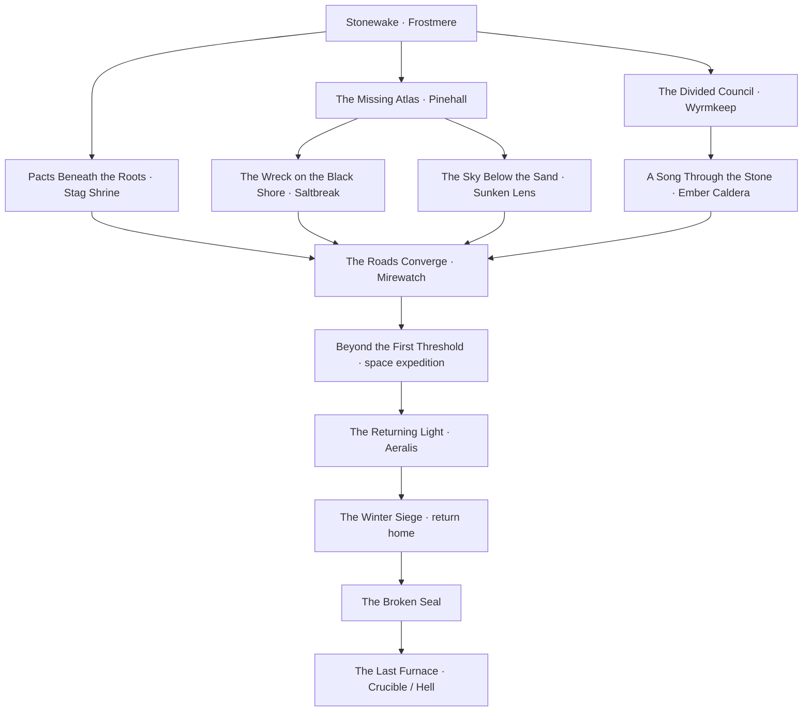

# The Northern Reach — first world atlas

The home world remains a Nordic-inspired RPG setting. Strong landscape changes make exploration memorable without turning every region into a different genre. This is a proposed geography and story structure for review, not a final scope cap or a claim that all regions are playable.

## Geography

| Region | Landscape and traversal | Places in the initial atlas |
| --- | --- | --- |
| Frostmarch | Glaciers, tundra, steep alpine passes; the northern mountain crown | Wyrmkeep, Rimegate Pass |
| Pineward | Sheltered conifer valleys, ancient watch roads and rivers | Frostmere, Pinehall |
| Westmere | Storm cliffs, fjords, fog, ports and dangerous coastal approaches | Saltbreak, Hallowcliff |
| Amberweald | Autumn forest, ancient roots, hunting trails and hidden groves | Alderrest, the Stag Shrine |
| Highmeadow | Open uplands, farms, orchards and contested river crossings | Larksbridge, Three Roads |
| Glassfen | Marshes, reed seas, flooded ruins, stilt towns and causeways | Mirewatch, Reedhollow |
| Sunscar Plateau | A dry eastern rain shadow: salt canyons, mesas and caravan routes | Dunewell, the Sunken Lens |
| Cinder Coast | Basalt shore, ash fields, geothermal vents and a volcanic sanctuary | Ashport, Ember Caldera |

The central mountain spine divides wetter western country from the dry eastern plateau. River systems flow from the northern heights toward the western fjords and southern lowlands. Passes and bridges create places where travel, trade and faction interests meet. The map's travel distances are schematic; physical region dimensions and streaming boundaries are not fixed yet.

Each region should eventually contain a social hub, smaller settlements or camps, at least one distinctive dungeon, wilderness discoveries, and several independent quest entry points. The sixteen named sites are the first anchors, not the final settlement count.

## Factions and joining

| Faction | Identity | Home | Main tension |
| --- | --- | --- | --- |
| Hearthbound Lodge | Rangers and wardens | Frostmere | Keep roads neutral or place them under clan control |
| Iron Pact | Mountain clans | Wyrmkeep | Independence of the holds versus centralized leadership |
| Veiled Lantern | Secretive scholars | Pinehall | Control dangerous knowledge or share it |
| Briar Coven | Woodland cult and healers | Stag Shrine | Protect old pacts while accommodating living towns |
| Sable Concord | Smugglers and information brokers | Dunewell | Independent routes versus a profitable secret monopoly |
| Ashen Choir | Volcanic mystery cult | Ember Caldera | Awaken, contain or silence a buried power |
| Tidemarch Compact | Sailors and merchant houses | Saltbreak | Shared trade law versus a dominant merchant house |

All seven are proposed joinable factions. Joining should be an in-world sequence: encounter a recruiter or discover the group, complete an initiation, then take an explicit oath. Each has three named rank concepts and a three-chapter arc in the catalog. Initiation and promotion mechanics are not implemented yet.

Membership in compatible groups should coexist. Simply meeting or helping a rival should not close an entire quest line. A clearly presented, consequential late allegiance choice may lock a rival capstone, with the consequences explained before commitment. The current rival pairs are Iron Pact/Ashen Choir, Veiled Lantern/Briar Coven, and Sable Concord/Tidemarch Compact. These are story proposals; no reputation, hostility or lockout code runs yet.

The main story should offer ways to work with groups without requiring the player to join every one. Quest availability should be driven by discoveries and relationships, not an arbitrary forced tour through every faction.

## Primary timeline and parallel adventures

The atlas holds **51 quest entries**: thirteen main-timeline entries, twenty-one faction chapter entries, and seventeen side-quest entries. **The Oldwatch Survey**, **An Ember Beneath Oldwatch** and **Stonewake** are playable in normal progression. The Divided Council and the first two Iron Pact chapters are also playable in Wyrmkeep. The Missing Atlas is playable in Pinehall. The Wreck on the Black Shore is playable in Saltbreak. The Sky Below the Sand is playable at the Sunken Lens. Pacts Beneath the Roots is playable at the Stag Shrine. A Song Through the Stone is playable at Ember Caldera. The Roads Converge is playable at Mirewatch. Beyond the First Threshold and The Returning Light are also playable in normal progression. The other 37 are campaign/faction/side outlines; The Returning Light and The Last Furnace have playable isolated realm slices awaiting their earlier campaign chapters.

After the opening, several main branches can advance in parallel. Independent faction chains and local side quests sit alongside this timeline. Quest catalog prerequisites capture the planned dependency graph. Stonewake, The Divided Council, The Missing Atlas, The Wreck on the Black Shore and The Sky Below the Sand now have running chapter controllers; the other main branches remain outlines. The space expedition precedes Aeralis, with the Crucible much later after the home-world siege and broken seal. Destination rewards stay usable at home. See REALMS.md.

Side-quest hooks include a missing apprentice, disputed water rights, a forged shipping ledger, a blighted harvest, a broken mill, refugees needing medicine and a lighthouse that was deliberately extinguished. Their initial names, locations and summaries are in `data/world_atlas.json`. Rewards, dialogue, NPC schedules, encounters, alternate objectives and branch resolution require later authoring.

## What runs now

- **M** opens the atlas, with world and Frostmere-area views, pan/zoom, markers, landscape selection, faction-seat overlay, route overlay and quest counts.
- Regional markers expose town/landmark, biome, faction connection and quest information. Frostmere, Wyrmkeep, Pinehall, Saltbreak and the Sunken Lens have playable local maps. Wyrmkeep is reached through the north pass after Stonewake; planned sites cannot trigger travel.
- The local map uses the same building footprints and generated tree positions as the current 3D scene, plus the actual player position and heading. Terrain shading is schematic, not an elevation survey. The distant fortress is labeled scenery.
- Five local sites can receive walking waypoints. There is no fast travel or teleport action.
- Begin the **Oldwatch Survey** from the map, inspect the forge with E, walk across the bridge, then inspect the relic with E. Objectives advance in order and only through valid in-world actions. It is a small exploration quest; it does not grant faction membership or invented loot.
- The HUD shows destination direction and distance. Manual waypoint labels stay distinct from the quest's current objective.
- Visited local sites, the waypoint and survey progress save to `user://atlas-progress-v1.json`. The loader validates IDs, stage bounds and schema before applying data. Player location, active area, resources and nearby surviving enemies now save in the character profile; transient projectiles and menu state are not restored.
- Headless tests, capture runs and benchmarks are isolated from real saved progress.

## Next implementation sequence

1. Build a playable Hearthbound recruiter, an initiation conversation and explicit membership choice around the existing survey route.
2. Add the first dungeon and combat encounter to Stonewake. Establish rewards, NPC state and a reusable branching quest runtime.
3. Expand Pineward toward one adjacent biome, with a second town and a rival faction representative. Prove traversal, streaming and performance before growing all eight regions.
4. Add reputation, rank progression and transparent allegiance decisions once two faction chains are playable.
5. Expand regional content and finally connect the supporting destination-world chapters.
