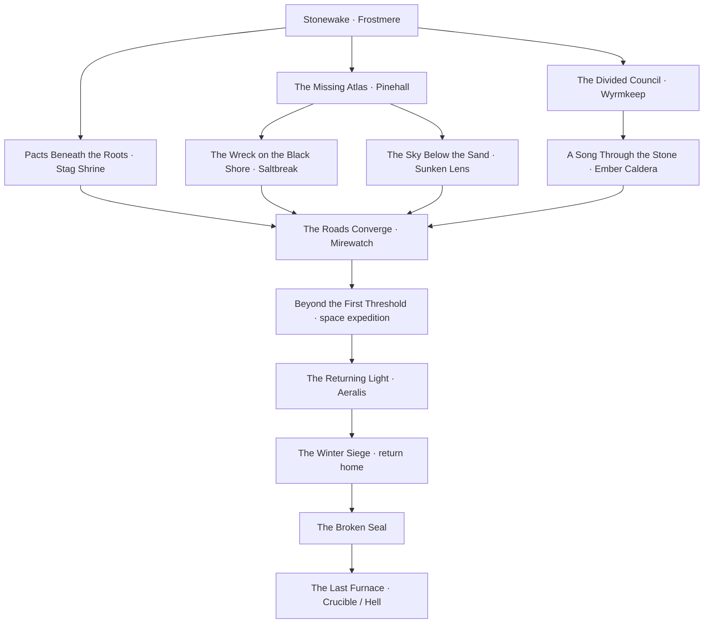

# The Northern Reach — atlas and faction guide

The home world remains a Nordic-inspired RPG setting. Strong landscape changes make exploration memorable without turning every region into a different genre. The atlas combines playable chapter regions with schematic geography. Its sixteen place labels do not mean sixteen fully built towns; caravan representatives and outposts stand in for some destinations.

## Geography

| Region | Landscape and traversal | Places in the initial atlas |
| --- | --- | --- |
| Frostmarch | Glaciers, tundra, steep alpine passes; the northern mountain crown | Wyrmkeep, Rimegate Pass |
| Pineward | Sheltered conifer valleys, ancient watch roads and rivers | Frostmere, Pinehall |
| Westmere | Storm cliffs, fjords, fog, ports and dangerous coastal approaches | Saltbreak, Hallowcliff |
| Amberweald | Autumn forest, ancient roots, hunting trails and hidden groves | Alderrest, the Stag Shrine |
| Highmeadow | Open uplands, farms, orchards and contested river crossings | Larksbridge, Three Roads |
| Glassfen | Marshes, reed seas, flooded ruins, stilt towns and causeways | Mirewatch, Reedhollow |
| Sunscar Plateau | A dry eastern rain shadow: salt canyons, mesas and caravan routes | Dunewell, the Sunken Lens |
| Cinder Coast | Basalt shore, ash fields, geothermal vents and a volcanic sanctuary | Ashport, Ember Caldera |

The central mountain spine divides wetter western country from the dry eastern plateau. River systems flow from the northern heights toward the western fjords and southern lowlands. Passes and bridges create places where travel, trade and faction interests meet. The map's travel distances are schematic; physical region dimensions and streaming boundaries are not fixed yet.

The geography is an authored design framework. Expansion is selected through [GitHub milestones](https://github.com/gonz0w/frostmere/milestones), rather than assigned by this atlas.

## Factions and joining

| Faction | Identity | Home | Main tension |
| --- | --- | --- | --- |
| Hearthbound Lodge | Rangers and wardens | Frostmere | Keep roads neutral or place them under clan control |
| Iron Pact | Mountain clans | Wyrmkeep | Independence of the holds versus centralized leadership |
| Veiled Lantern | Secretive scholars | Pinehall | Control dangerous knowledge or share it |
| Briar Coven | Woodland cult and healers | Stag Shrine | Protect old pacts while accommodating living towns |
| Sable Concord | Smugglers and information brokers | Dunewell | Independent routes versus a profitable secret monopoly |
| Ashen Choir | Volcanic mystery cult | Ember Caldera | Awaken, contain or silence a buried power |
| Tidemarch Compact | Sailors and merchant houses | Saltbreak | Shared trade law versus a dominant merchant house |

All seven factions have compact playable initiation and promotion chains. Joining uses in-world tasks and an explicit oath; rank, rewards and story choices persist. See the faction guide links below. Membership is not a simulation of faction patrols, trade or government.

Membership can coexist. The Sable Concord and Tidemarch Compact finales have explicit hostile choices that can close the rival finale; peaceful outcomes work in either order, and completed rival finales cannot be retroactively invalidated. See [Safe Passage](SAFE_PASSAGE.md) and [the Concord road quests](ROAD_QUESTS.md). The [Choir conquest ending](FIRE_INVITE.md) closes an unfinished Iron Pact Clan Voice finale; conquest is unavailable if Clan Voice is already complete. Veiled Lantern/Briar Coven tension does not impose a rival-finale lockout. There is no general automatic hostility system. Individual chapter guides describe their recorded consequences.

The main story should offer ways to work with groups without requiring the player to join every one. Quest availability should be driven by discoveries and relationships, not an arbitrary forced tour through every faction.

## Primary timeline and parallel adventures

All atlas quests have playable implementations; [current counts](CONTENT_REFERENCE.md) distinguish main, faction and side entries. The main route connects Oldwatch and Stonewake through the branch investigations, station expedition, Aeralis, home-world siege, Broken Seal and Crucible ending. Normal gates enforce prerequisites; isolated previews do not replace the connected campaign.

After Stonewake, the council, archive and woodland investigations can advance along their prerequisites. Mirewatch convergence requires the woodland, coastal, lens and choir investigations. The space expedition precedes Aeralis; the Crucible follows Winter Siege and Broken Seal. Destination equipment remains usable at home. See [realm access](REALMS.md).

Side quests include the missing apprentice, disputed water rights, forged shipping records, blighted harvest, stopped mill, refugee rescue and extinguished lighthouse. Their objectives, rewards and choices are implemented in compact authored areas. This does not imply NPC schedules or a simulated continent. [Road quests](ROAD_QUESTS.md) explains the representative camps and outposts.

## What runs now

- **M** opens the atlas, with world and Frostmere-area views, pan/zoom, markers, landscape selection, faction-seat overlay, route overlay and quest counts.
- Regional markers expose town/landmark, biome, faction connection and quest information. Playable chapter areas have local maps, including the later woodland, caldera, expedition, siege and realm areas. Wyrmkeep is reached through the north pass after Stonewake; planned sites cannot trigger travel.
- The local map uses the same building footprints and generated tree positions as the current 3D scene, plus the actual player position and heading. Terrain shading is schematic, not an elevation survey. The distant fortress is labeled scenery.
- Five local sites can receive walking waypoints. There is no fast travel or teleport action.
- Begin the **Oldwatch Survey** from the map, inspect the forge with E, walk across the bridge, then inspect the relic with E. Objectives advance in order and only through valid in-world actions. It is a small exploration quest; it does not grant faction membership or invented loot.
- The HUD shows destination direction and distance. Manual waypoint labels stay distinct from the quest's current objective.
- Visited local sites, the waypoint and survey progress save to `user://atlas-progress-v1.json`. The loader validates IDs, stage bounds and schema before applying data. Player location, active area, resources and nearby surviving enemies now save in the character profile; transient projectiles and menu state are not restored.
- Headless tests, capture runs and benchmarks are isolated from real saved progress.

## Faction guides

- [Hearthbound initiation](HEARTHBOUND.md), [Waykeeper](WATERSHED.md), [Warden](WARDEN.md).
- [Iron Pact initiation and promotions](WYRMKEEP.md).
- [Veiled Lantern initiation and promotions](LANTERN.md).
- [Briar Coven initiation and promotions](COVEN.md).
- [Sable Concord's three road chapters](ROAD_QUESTS.md).
- [Ashen Choir Listener](CHOIR_LISTENER.md), [Cantor](ASH_MEMORY.md), [Ember Voice](FIRE_INVITE.md).
- [Tidemarch Decksworn](TIDE_COMPACT.md), [Envoy](HARBOR_LIED.md), [Harbor Speaker](SAFE_PASSAGE.md).

[Milestones](https://github.com/gonz0w/frostmere/milestones) own future selection.
For earlier development context, see [scope history](SCOPE.md) and
[development history](DEVELOPMENT_HISTORY.md); neither assigns current work.
